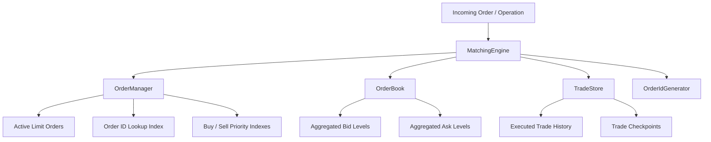
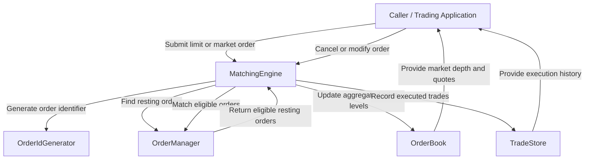
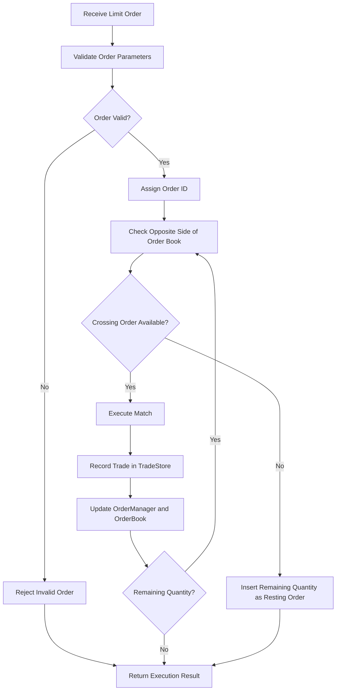

# cmarket — Architecture Diagrams

## 1. High-Level System Architecture

cmarket is a C++20 exchange-style matching engine that supports
limit orders, market orders, price-time priority matching, partial
fills, cancellation, modification, and persistent in-memory
trade history.

The system separates order execution from active-order storage,
aggregated order-book data, and trade recording.

## 2. Core Components

### MatchingEngine

Coordinates order placement, matching, market-order execution,
cancellation, modification, and rollback.

It enforces price-time priority and synchronizes changes across
the system's stateful components.

### OrderManager

Maintains individual active limit orders.

It uses:
- A vector for authoritative active-order storage
- An unordered index for expected O(1) Order ID lookup
- Ordered buy and sell indexes for price-time priority

### OrderBook

Maintains aggregated bid and ask price levels.

It provides market information such as best bid, best ask,
spread, market depth, VWAP, and other book statistics.

Internal access is synchronized using std::shared_mutex.

### TradeStore

Maintains executed trades in memory, including trade identifiers
and execution ordering.

It also provides checkpoints for rollback-sensitive operations.

### OrderIdGenerator

Generates order identifiers used to distinguish orders.

## 3. Important Architectural Properties

- Matching follows price-time priority.
- FIFO priority is based on sequence numbers.
- Active orders are stored separately from aggregate price levels.
- Trades are recorded in an in-memory history.
- Rollback-sensitive operations use checkpoints and mutation journals.
- OrderBook synchronization does not imply that the entire
  MatchingEngine supports concurrent writers.

## 4. Additional Documentation

For detailed implementation decisions, invariants, complexity
analysis, rollback behavior, and concurrency limitations, see
[Architecture Documentation](architecture.md).

## 5. Component Interaction Diagram

This diagram illustrates the logical interactions between
the matching engine, order manager, order book, and trade store.

### Component Responsibilities

| Component | Responsibility |
|---|---|
| MatchingEngine | Coordinates order processing, matching, and execution |
| OrderManager | Stores and retrieves active orders |
| OrderBook | Maintains aggregated bid and ask levels |
| TradeStore | Records executed trades |
| OrderIdGenerator | Generates unique order identifiers |

### Interaction Summary

1. A caller submits an order or requests an operation.
2. MatchingEngine validates and processes the request.
3. OrderManager provides access to active resting orders.
4. MatchingEngine determines and executes eligible matches.
5. OrderBook is updated to reflect changes in market depth.
6. TradeStore records completed executions.
7. The operation returns its result to the caller.

The diagram represents logical interactions rather than
a strict sequence of function calls.

## 6. Limit Order Processing Flow

This diagram illustrates the logical flow of a limit
order through the cmarket matching engine.

### Order Processing Explanation

1. **Receive Order:** The matching engine receives an incoming limit order.
2. **Validation:** The engine validates price, quantity, and other required parameters.
3. **Order Identification:** A valid order receives an order identifier.
4. **Matching:** The engine searches for eligible orders on the opposite side using price-time priority.
5. **Trade Execution:** Compatible orders execute, potentially producing partial fills.
6. **State Updates:** Executed trades are recorded and active order quantities and aggregated price levels are updated.
7. **Remaining Quantity:** Any unfilled quantity is added as a resting limit order when matching is no longer possible.
8. **Result:** The engine returns the result of the operation.

### Price-Time Priority

cmarket prioritizes orders according to two rules:

- **Price Priority:** Better prices execute first.
- **Time Priority:** At the same price, earlier orders execute first.

This supports deterministic FIFO matching among orders at the same price level.

### Partial Fills

If an incoming order is larger than the available quantity
of a matching resting order, that resting order is fully
executed and the engine continues matching the remaining
incoming quantity against the next eligible order.
