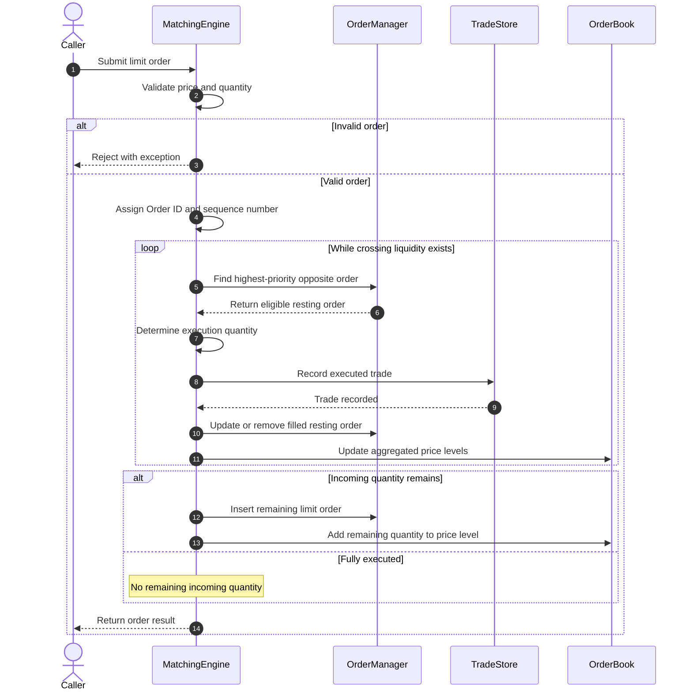
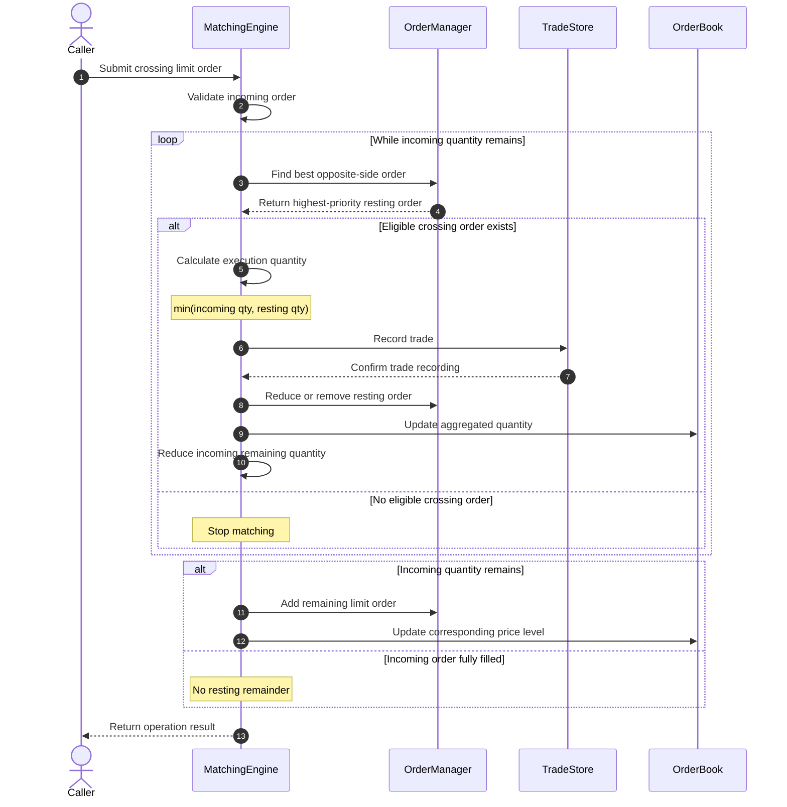
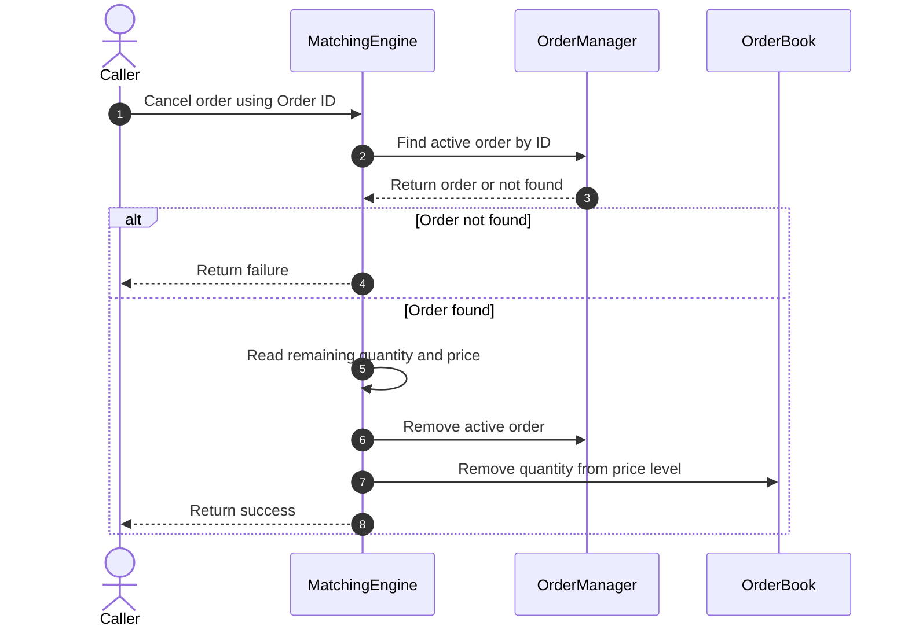
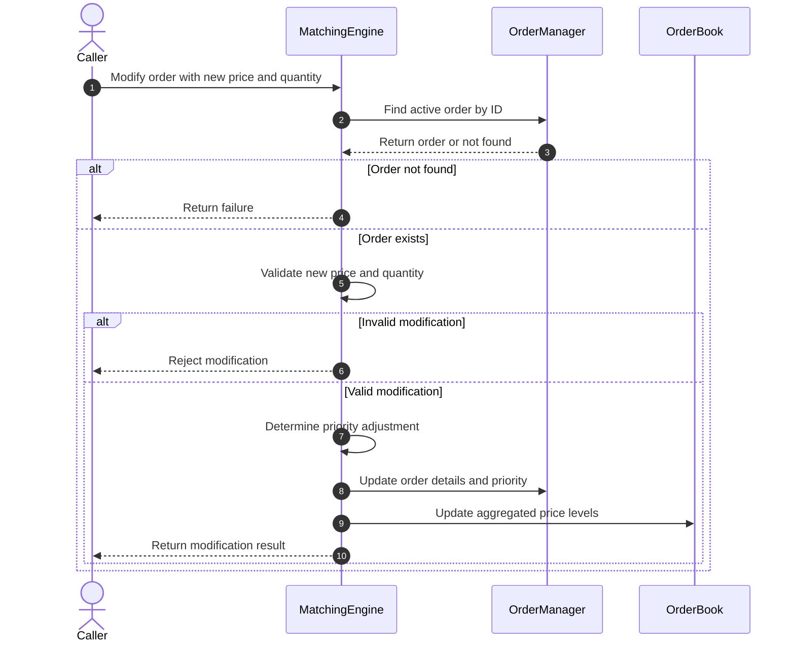
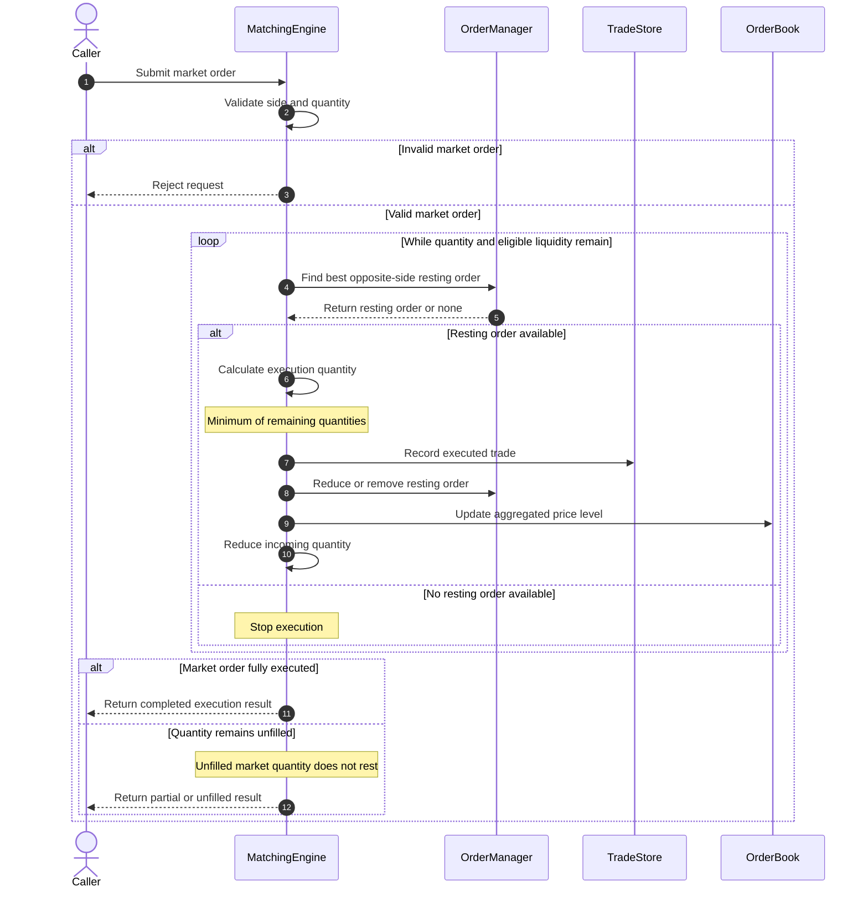

# cmarket — Sequence Diagrams

## 1. Limit Order Placement

### Overview

This sequence diagram describes how cmarket processes
an incoming limit order.

The MatchingEngine validates the order, identifies eligible
resting orders, executes matches using price-time priority,
records trades, and updates the active-order state.

If any quantity remains unmatched, it becomes a resting
limit order.

### Sequence Diagram

### Processing Stages

1. **Order Submission**
   The caller submits a limit buy or sell order with
   a price and quantity.

2. **Validation**
   MatchingEngine checks that price and quantity are
   positive and valid.

3. **Order Identification**
   The engine assigns an Order ID and FIFO sequence
   information to the incoming order.

4. **Price-Time Priority**
   Eligible resting orders are selected by best price
   first and earliest sequence number second.

5. **Trade Execution**
   The engine determines executable quantities and
   records completed trades through TradeStore.

6. **State Synchronization**
   OrderManager updates active resting orders while
   OrderBook maintains aggregated price levels.

7. **Remaining Quantity**
   If the incoming order is partially filled or
   unmatched, its remaining quantity becomes a
   resting limit order.

8. **Result**
   The engine returns control to the caller.

### Important Properties

- Buy orders match against eligible sell orders.
- Sell orders match against eligible buy orders.
- Better resting prices execute before worse prices.
- Earlier orders at the same price execute first.
- A single incoming order can generate multiple trades.
- Fully filled orders must not remain active.
- Unmatched limit-order quantities remain available
  for future matching.
- Invalid orders must not corrupt existing engine state.

### Notes

This is a logical sequence diagram, not a one-to-one
trace of every internal C++ function call.

Rollback-sensitive paths may use mutation journals
and checkpoints to preserve engine invariants when
an operation fails.

## 2. Automatic Order Matching

### Overview

When a new limit order crosses the best available price
on the opposite side of the order book, cmarket attempts
to match it against resting orders.

Matching follows price-time priority and supports partial
fills and multiple executions.

### Sequence Diagram

### Matching Rules

1. **Price Priority:** Buy orders target the lowest eligible
   sell price. Sell orders target the highest eligible buy price.

2. **Time Priority:** Orders at the same price execute in
   FIFO order using their sequence numbers.

3. **Execution Quantity:** Each match executes the smaller
   of the incoming remaining quantity and the resting
   order's available quantity.

4. **Partial Fill:** If an order is only partially executed,
   its remaining quantity is retained or processed further.

5. **Multiple Trades:** One incoming order can match against
   several resting orders.

6. **Order Book Updates:** The aggregated quantity at each
   affected price level is updated after execution.

### Example

Assume the following resting sell orders exist:

| Order | Price | Quantity | Priority |
|---|---:|---:|---:|
| Sell A | $100 | 30 | First |
| Sell B | $100 | 20 | Second |
| Sell C | $101 | 40 | Third |

An incoming buy limit order has:

- Limit price: $101
- Quantity: 70

Expected matching behavior:

1. Buy 30 units from Sell A at $100.
2. Buy 20 units from Sell B at $100.
3. Buy 20 units from Sell C at $101.

The incoming buy order is fully filled.

Sell C retains 20 units, while Sell A and Sell B
are removed from the active order book.

This example demonstrates price priority, FIFO
time priority, and partial fills.

### Architectural Notes

- MatchingEngine coordinates the matching operation.
- OrderManager identifies and updates active orders.
- TradeStore records individual executions.
- OrderBook maintains aggregated bid and ask quantities.
- Matching should preserve system invariants if an
  operation fails.

## 3. Cancel Order

### Overview

The cancellation process removes an active limit order
from the matching engine.

The system must update both the individual order records
and the aggregated order-book quantities.

### Sequence Diagram

### Cancellation Rules

1. A cancellation request identifies an order using its Order ID.
2. The engine checks whether the order is currently active.
3. Unknown or inactive order IDs must not alter the order book.
4. Successful cancellation removes the remaining unfilled quantity.
5. Aggregated price-level quantities must remain consistent.
6. Previously executed trades remain in TradeStore.

---

## 4. Modify Order

### Overview

Modification allows an existing active limit order to
change its price or quantity.

The system must maintain price-time priority and keep
the OrderManager and OrderBook synchronized.

### Sequence Diagram

### Modification Rules

- The order must exist and be active.
- The new price and quantity must be valid.
- Price changes require updating the affected price levels.
- Changes affecting time priority must follow the
  matching engine's FIFO policy.
- OrderManager and OrderBook must remain synchronized.
- Invalid modifications must leave existing state unchanged.

### Important Design Consideration

When an order's price changes, it may become eligible
for immediate matching.

The implementation must determine whether the modified
order is reprocessed by the matching engine or simply
updated as a resting order.

The exact sequence of internal updates and the policy
for retaining or resetting time priority should match
the implemented modification behavior.

## 5. Market Order Execution

### Overview

A market order attempts to execute immediately against
available resting limit orders on the opposite side.

Unlike a limit order, a market order does not specify a
limit price. It consumes available liquidity according
to price-time priority.

Any quantity that cannot be executed is not added to
the resting order book.

### Sequence Diagram

### Market Order Processing Rules

1. **Validation:** The engine validates the market-order
   side and requested quantity.

2. **Best Available Price:** A buy market order consumes
   resting sell liquidity from the lowest ask upward.
   A sell market order consumes resting buy liquidity
   from the highest bid downward.

3. **FIFO Priority:** At the same price, earlier
   resting orders execute before later orders.

4. **Partial Fills:** An incoming market order can
   execute against multiple resting orders.

5. **Liquidity Exhaustion:** Matching stops when there
   are no more available opposite-side orders.

6. **No Resting Market Orders:** Unfilled market-order
   quantity is not inserted into the order book.

7. **Trade Recording:** Each completed execution is
   recorded in TradeStore.

### Example

Suppose the order book contains:

| Resting sell order | Price | Quantity |
|---|---:|---:|
| Sell A | $100 | 20 |
| Sell B | $101 | 30 |
| Sell C | $102 | 10 |

An incoming buy market order requests 75 units.

Expected execution:

1. Execute 20 units against Sell A at $100.
2. Execute 30 units against Sell B at $101.
3. Execute 10 units against Sell C at $102.
4. Stop because no additional sell liquidity exists.

Result:

- Requested quantity: 75
- Executed quantity: 60
- Unfilled quantity: 15
- Executed trades: 3

The remaining 15 units do not become a resting order.

### Architectural Notes

- MatchingEngine coordinates market-order execution.
- OrderManager supplies resting orders by priority.
- TradeStore records executed trades.
- OrderBook reflects updated market depth.
- Execution behavior and error handling must follow
  the implemented C++ interfaces.
